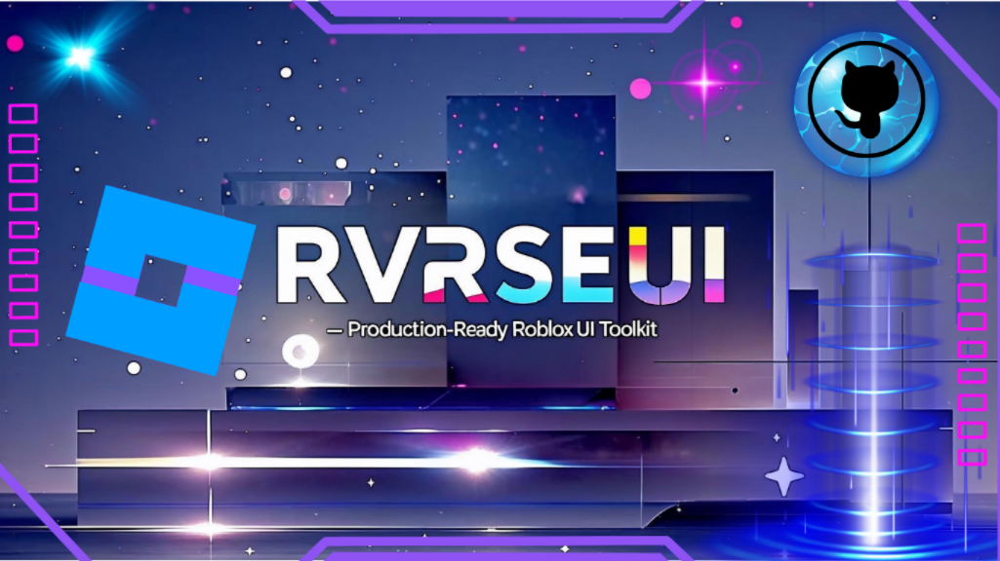

# RvrseUI



All documentation, demos, changelogs, and troubleshooting guides now live on the RvrseUI GitHub Pages site.

**Current release: v4.10.0**

- **Visit the docs:** https://coderrvrse.github.io/RvrseUI/
- **Source + issues:** https://github.com/CoderRvrse/RvrseUI
- **Community + support:** https://discord.gg/FJxrnAcawn

Hubs can point players at their *own* Discord instead — set
`DiscordInvite` once in `CreateWindow` and both the main window and the key
window use it. Left unset, windows show the community invite above; set it to
`false` for no badge at all.

## ⛔ Contributing: read this first

**Before you build or commit, run:**

```sh
node tools/doctor.js
```

`git status` can report a file as **clean when it is not**. `core.autocrlf`
rewrites line endings on checkout and git's stat cache hides it, so you end up
building `RvrseUI.lua` from a source file that **does not exist in the
repository** — and it looks correct on your machine forever, because every
re-run reproduces the same corruption.

This has shipped a wrong artifact. It is the single most expensive mistake in
this repo's history, and it is invisible without that command.

- Never edit `RvrseUI.lua` by hand — edit `src/`, then `node tools/build.js`
- Never remove `* -text` from `.gitattributes`
- Full explanation and recovery steps: **[docs/LINE-ENDINGS.md](docs/LINE-ENDINGS.md)**

Need the monolith fast?

```lua
loadstring(game:HttpGet("https://raw.githubusercontent.com/CoderRvrse/RvrseUI/main/RvrseUI.lua"))()
```

MIT License. Built by CoderRvrse.
